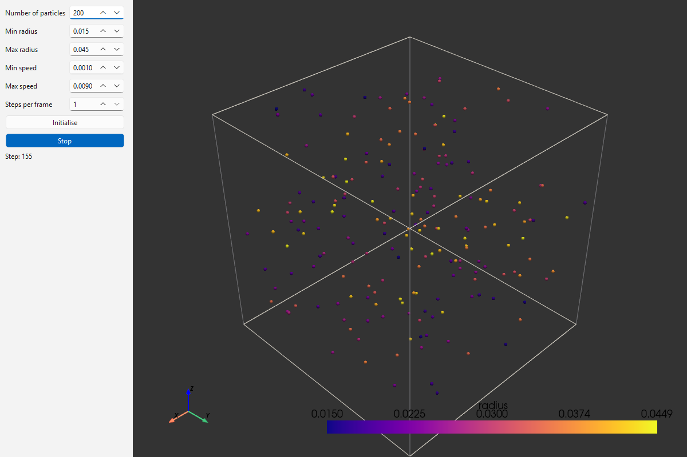

Project - Particles in a box
============================

In this project you will simulate a large number of spherical particles
moving in a closed three-dimensional box. The particles bounce off the
walls of the box and off each other. The simulation is implemented in
modern Fortran. The same Fortran code is used from a Fortran main
program and from Python, through an extension module built with f2py.
Finally, you will build an interactive simulator with a Qt user
interface and a 3D view of the particles.

   The interactive particle simulator from task 3.

You are given a skeleton with the build system, the module structure
and the visualisation code. Your task is to complete the parts marked
``TODO``.

The project covers:

* Derived types with type-bound procedures and finalization
* Modules and submodules
* Array operations and the memory layout of Fortran arrays
* Calling Fortran from Python with f2py
* Building mixed Fortran and Python projects with CMake
* Graphical user interfaces with Qt and 3D visualisation with PyVista

The model
---------

Each particle :math:`i` has a position :math:`\mathbf{s}_i`, a velocity
:math:`\mathbf{v}_i` and a radius :math:`r_i`. The particles move inside
the box :math:`[-1, 1] \times [-1, 1] \times [-1, 1]`. All particles
have the same mass.

Initial conditions
~~~~~~~~~~~~~~~~~~

The simulation starts with random values for all particles:

* The radius :math:`r_i` is random in :math:`[r_{min}, r_{max}]`.
* The speed :math:`v` is random in :math:`[v_{min}, v_{max}]` and the
  direction is given by two random angles,
  :math:`\varphi \in [0, 2\pi]` and
  :math:`\theta \in [-\pi/2, \pi/2]`:

  .. math::

     \mathbf{v}_i = v \begin{bmatrix}
         \cos\varphi \cos\theta \\
         \sin\varphi \cos\theta \\
         \sin\theta
     \end{bmatrix}

* The position :math:`\mathbf{s}_i` is random inside the box, at least
  one diameter :math:`2 r_i` from the walls.

Time step
~~~~~~~~~

The particles are moved with a fixed time step. If a particle moves too
far in one step, collisions can be missed and particles can pass
through each other. The time step is chosen so that no particle moves
more than a third of the smallest radius:

.. math::

   \Delta t = \frac{r_{min}}{3 v_{max}}

Simulation step
~~~~~~~~~~~~~~~

Each time step consists of three parts:

1. Check for collisions between particles and update their velocities.
2. Check for collisions with the walls and update the velocities.
3. Move all particles to their new positions:

   .. math::

      \mathbf{s}_i \leftarrow \mathbf{s}_i + \mathbf{v}_i \Delta t

Collisions with the walls
~~~~~~~~~~~~~~~~~~~~~~~~~

A particle hits a wall when its distance to the wall is less than its
radius. The velocity component perpendicular to the wall must then
point back into the box. For the walls perpendicular to the
:math:`x`-axis:

.. math::

   s_{i,x} < x_{min} + r_i \Rightarrow v_{i,x} \leftarrow |v_{i,x}|
   \qquad
   s_{i,x} > x_{max} - r_i \Rightarrow v_{i,x} \leftarrow -|v_{i,x}|

and in the same way for :math:`y` and :math:`z`. Setting the direction,
instead of just changing the sign of the velocity, keeps particles from
getting stuck in a wall.

Collisions between particles
~~~~~~~~~~~~~~~~~~~~~~~~~~~~

For a pair of particles :math:`i` and :math:`j`, let

.. math::

   \mathbf{n} = \mathbf{s}_j - \mathbf{s}_i

The particles collide if they overlap and are moving towards each
other:

.. math::

   |\mathbf{n}| < r_i + r_j
   \quad \text{and} \quad
   \mathbf{n} \cdot (\mathbf{v}_j - \mathbf{v}_i) < 0

For an elastic collision between particles of equal mass, the velocity
components along :math:`\mathbf{n}` are exchanged:

.. math::

   q = \frac{\mathbf{n} \cdot (\mathbf{v}_j - \mathbf{v}_i)}{\mathbf{n} \cdot \mathbf{n}},
   \qquad
   \mathbf{v}_i \leftarrow \mathbf{v}_i + q \mathbf{n},
   \qquad
   \mathbf{v}_j \leftarrow \mathbf{v}_j - q \mathbf{n}

Collisions between more than two particles at the same time can be
ignored.

Both kinds of collisions conserve the kinetic energy, so
:math:`\sum_i |\mathbf{v}_i|^2` should stay constant during the
simulation. This is a useful check of your implementation.

The skeleton
------------

Download the skeleton code from the course page. It contains::

    particles_project/
        CMakeLists.txt               Build of the whole project
        configure_build.cmd/.sh      Configure and build
        build.cmd/.sh                Rebuild after changes
        clean.cmd/.sh                Remove build files
        run_fortran.cmd/.sh          Run the Fortran program
        run_python.cmd/.sh           Run a Python program
        particles.py                 Python program (task 2)
        particles_qt.py              Interactive simulator (task 3)
        particles_player.py          Plays back a particle.state file
        src/
            common/
                mf_datatypes.f90     Kind parameters and constants
                particle_data.f90    The particle_system type (task 1)
                particle_sim.f90     Simulation procedures (task 1)
                particle_state.f90   Particle system used from Python
            particles/
                main.f90             Fortran main program (task 1)
            particle-lib/
                particle_driver.f90  Interface wrapped by f2py (task 2)

The skeleton builds and runs without changes, but does not simulate
anything until you have completed the ``TODO`` parts.

Setting up the environment
~~~~~~~~~~~~~~~~~~~~~~~~~~

You need a Fortran compiler, gfortran 9 or newer, in your ``PATH``. On
Windows use a MinGW-w64 gfortran, for example from MSYS2, WinLibs or
the MinGW toolchain installed with Qt.

Create a conda environment with the Python packages and build tools:

.. code-block:: text

   conda create -n particles-project -c conda-forge python=3.12 numpy meson ninja cmake pyvista pyvistaqt pyside6
   conda activate particles-project

On Linux and macOS you can add ``gfortran`` to the list to get the
compiler from conda-forge as well.

Building and running
~~~~~~~~~~~~~~~~~~~~

Always activate the environment before building or running. Build the
project from the project directory with:

.. code-block:: text

   configure_build.cmd          (Windows)
   ./configure_build.sh         (Linux / macOS)

This builds the Fortran program ``bin/particles``, the library
``lib/libparticle.a`` and the Python extension module ``particle`` in
``bin/``. After changing the code, rebuild with ``build.cmd`` or
``./build.sh``.

The Fortran program and ``particles.py`` write the particle positions
for each step to ``particle.state``. Use the player to view the result:

.. code-block:: text

   run_fortran.cmd
   run_python.cmd particles_player.py

On Linux and macOS use the ``.sh`` scripts instead. The player is
useful for debugging task 1, before the Python interface is done.

Task 1 - The Fortran simulation
-------------------------------

The simulation is built around the type ``particle_system`` in
``particle_data.f90``:

.. code-block:: fortran

   type :: particle_system
       integer(ik) :: n_particles = 0
       real(dp) :: box_min(3) = -1.0_dp
       real(dp) :: box_max(3) = 1.0_dp
       real(dp) :: r_min = 0.0_dp
       real(dp) :: r_max = 0.0_dp
       real(dp) :: v_max = 0.0_dp
       real(dp) :: dt = 0.0_dp
       real(dp), allocatable :: pos(:,:)
       real(dp), allocatable :: vel(:,:)
       real(dp), allocatable :: r(:)
       integer :: state_unit = -1
   contains
       procedure :: init
       procedure :: destroy
       procedure :: print_info
       procedure :: write_sizes
       procedure :: write_positions
       procedure :: write_n_iterations
       procedure :: update
       procedure :: check_boundary
       procedure :: check_collision
       final :: finalize
   end type particle_system

The procedures are type-bound, so they are called on a variable of the
type, for example ``call psys%update()``. Note the following:

* Positions and velocities are stored with shape ``(3, n_particles)``.
  Fortran stores arrays column by column, so the three coordinates of a
  particle are next to each other in memory. ``pos(:,i)`` is the
  position vector of particle ``i``.
* The simulation procedures ``update``, ``check_boundary`` and
  ``check_collision`` are declared in an interface block in
  ``particle_data.f90`` and implemented in the submodule
  ``particle_sim`` in ``particle_sim.f90``. A submodule separates the
  interface of a module from its implementation. Changing the
  implementation does not require recompiling the code that uses the
  module.
* The final procedure ``finalize`` is called automatically when a
  ``particle_system`` variable goes out of scope. It releases the arrays
  and closes the state file. Variables in the main program are never
  finalized, which is why the main program declares the particle system
  inside a ``block``.

The procedures for writing the state file, ``destroy`` and
``print_info`` are already implemented.

Implement the following:

1. ``init`` in ``particle_data.f90``: initialise the particle system
   with random values as described in `Initial conditions`_. Store the
   parameters and the time step in the type and allocate the arrays.
   Use ``random_init`` to initialise the random number generator and
   whole array operations where possible.

2. ``update`` in ``particle_sim.f90``: move the particles one time step.
   Use the optional argument ``dt`` if it is given, otherwise the time
   step stored in the type.

3. ``check_boundary`` in ``particle_sim.f90``: collisions with the walls
   as described in `Collisions with the walls`_.

4. ``check_collision`` in ``particle_sim.f90``: collisions between
   particles as described in `Collisions between particles`_. Compare
   squared distances to avoid computing square roots.

5. The main program in ``main.f90``: initialise a system of 500
   particles, write the sizes and the number of steps to the state file,
   run 1000 time steps and print a summary.

Run the program and view the result with the player. Check that:

* the particles stay inside the box,
* particles bounce off each other when they meet,
* the kinetic energy :math:`\sum_i |\mathbf{v}_i|^2` is the same before
  and after the simulation (compute and print it in the main program).

Task 2 - Calling the simulation from Python
-------------------------------------------

The Python extension module is built with f2py from
``particle_driver.f90``. Only this file is processed by f2py. It is
linked with the library containing the rest of the Fortran code. The
build is handled by CMake (see ``src/particle-lib/CMakeLists.txt``).

f2py can only handle procedures with simple arguments, such as numbers
and arrays. It can not handle derived types or kind parameters defined
in other modules. The driver therefore uses plain ``real(8)`` and
``integer`` arguments, and operates on a particle system stored as a
module variable, ``psys``, in the module ``particle_state``.

In Python the driver procedures are available as functions in the
module ``particle.particle_driver``:

.. code-block:: python

   from particle import particle_driver

   particle_driver.init_system(n_particles, r_min, r_max, v_min, v_max)

Arrays that Fortran should fill in, such as the positions, must be
created in Python with Fortran ordering, so that f2py can pass them to
Fortran without copying:

.. code-block:: python

   positions = np.zeros((n_particles, 3), order='F')
   particle_driver.get_positions(positions)

Implement the following:

1. The driver procedures in ``particle_driver.f90``. Each procedure
   calls the corresponding method of ``psys``. Note that Python uses
   arrays of shape ``(n_particles, 3)`` for the positions, while the
   particle system stores them as ``(3, n_particles)``.

2. The Python program ``particles.py``: run the same simulation as the
   Fortran main program, with 1000 particles and 500 steps, and write
   the result to ``particle.state``. Check the result with the player.

Task 3 - Interactive simulator
------------------------------

In this task you will complete an interactive simulator,
``particles_qt.py``. The window has input fields for the simulation
parameters to the left and a 3D view to the right. The 3D view is a
PyVista plotter embedded in the Qt window with ``pyvistaqt``. The
particles are shown as points rendered as spheres and coloured by their
radius.

The program consists of two classes:

* ``ParticleSimulation`` is a Python interface to the Fortran
  simulation. It keeps the arrays with positions and sizes and counts
  the steps.
* ``MainWindow`` is the main window. The input fields, buttons, the 3D
  view and a ``QTimer`` that drives the animation are already created.

Implement the following:

1. The methods ``init``, ``step`` and ``cleanup`` in
   ``ParticleSimulation``.

2. ``on_initialise`` in ``MainWindow``, called when the
   :guilabel:`Initialise` button is clicked. Read the parameters from
   the input fields, check that the minimum values are not larger than
   the maximum values and initialise a new particle system.

3. ``on_run_toggled``, called when the :guilabel:`Start` button is
   toggled. Start or stop the timer and change the text of the button.

4. ``on_timer``, called by the timer. Advance the simulation the number
   of steps given by :guilabel:`Steps per frame` and update the 3D
   view.

The simulator should be possible to run, stop, re-initialise with new
parameters and run again.

Optional extensions
-------------------

If you want to do more, here are some suggestions:

* **Performance.** The collision check compares all pairs of particles,
  which takes :math:`O(N^2)` time. Implement a cell list: divide the box
  into cells at least :math:`2 r_{max}` wide and only check particles in
  the same and neighbouring cells. Compare the run time for different
  numbers of particles.
* **OpenMP.** Parallelise the simulation with OpenMP. Which loops can
  be parallelised safely?
* **Particles with different masses.** Let the mass be proportional to
  :math:`r^3`. The collision then becomes

  .. math::

     \mathbf{v}_i \leftarrow \mathbf{v}_i + \frac{2 m_j}{m_i + m_j} q \mathbf{n},
     \qquad
     \mathbf{v}_j \leftarrow \mathbf{v}_j - \frac{2 m_i}{m_i + m_j} q \mathbf{n}

  Check that the kinetic energy :math:`\sum_i m_i |\mathbf{v}_i|^2 / 2`
  is conserved.
* **Gravity.** Add a constant acceleration in the :math:`-z` direction.
* **Visualisation.** Show the particles as spheres with their true
  radius, for example with ``pyvista.PolyData.glyph``. Plot the kinetic
  energy or the speed distribution during the simulation.
* **Python comparison.** Implement the collision check in NumPy and
  compare the performance with the Fortran version.

What to hand in
---------------

* The complete source code, without build directories.
* A short report describing:

  * your implementation of the simulation procedures,
  * how you checked that the simulation is correct,
  * screenshots of the interactive simulator,
  * any optional extensions you have done.
